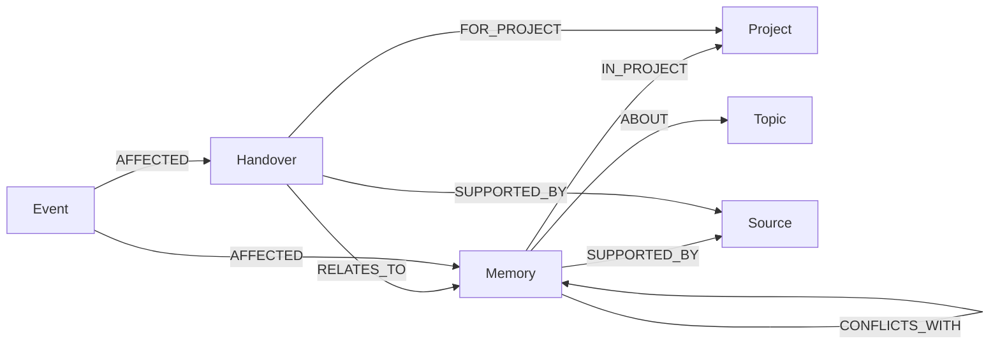

# Knowledge Brain — Graph Database Schema (Kuzu)

> [!IMPORTANT]
> This schema is designed to be **edge-case-proof** for multi-agent coding memory (OpenCode, Antigravity, etc.). It avoids duplicating Git/filesystem state (`File` or `Technology` nodes) and instead models **decisions, constraints, failed attempts, preferences, handovers, provenance, and audit events** with branch-aware supersession.

## 1. Visual Graph Model



---

## 2. Kuzu DDL Schema

> [!NOTE]
> Kuzu enforces primary keys, column types, and edge directionality at the database level. Enum validation (`status`, `kind`, `authority`) and cross-field uniqueness rules are enforced in the Database Access Layer.

### Node Tables (6 Tables)

```cypher
-- 1. PROJECT: Stable identity across folder moves, clones, and git worktrees
CREATE NODE TABLE Project (
    id STRING,                      -- Canonical hash: remote_url OR root_commit OR abs_path
    name STRING,                    -- Human-readable name (e.g., "contest-platform")
    git_remote_url STRING,          -- Normalized remote (nullable for local-only repos)
    root_commit_hash STRING,        -- First commit SHA; survives folder renames & remote changes
    local_paths STRING[],           -- All known local paths / worktrees for this repo
    default_branch STRING,          -- e.g., "main"
    created_at TIMESTAMP,
    updated_at TIMESTAMP,
    PRIMARY KEY (id)
);

-- 2. TOPIC: Normalized concept hubs to cluster memories without full-graph scans
CREATE NODE TABLE Topic (
    id STRING,                      -- Normalized slug: e.g., "auth", "database", "testing"
    display_name STRING,            -- Human-readable: "Authentication"
    aliases STRING[],               -- e.g., ["authn", "login", "jwt"]
    created_at TIMESTAMP,
    PRIMARY KEY (id)
);

-- 3. MEMORY: Unified durable knowledge (decisions, constraints, failures, preferences)
CREATE NODE TABLE Memory (
    id STRING,                      -- UUIDv7 (time-sortable)
    scope STRING,                   -- "global" | "project"
    branch STRING,                  -- "*" (repo-wide), "main", "feat/mongo", or "__default__"
    kind STRING,                    -- "decision" | "constraint" | "failed_attempt" | "preference"
    subject_key STRING,             -- Granular key to avoid false overwrites, e.g. "db:primary", "db:cache"
    title STRING,                   -- Short 1-line summary (indexed for FTS)
    content STRING,                 -- The WHY, trade-offs, and details (indexed for FTS)
    status STRING,                  -- "active" | "proposed" | "conflicted" | "superseded" | "deleted" | "expired"
    authority STRING,               -- "user" | "verified" | "agent"
    confidence DOUBLE,              -- 0.0 to 1.0
    embedding FLOAT[384],           -- Dense semantic vector (e.g. all-MiniLM-L6-v2) for semantic recall
    tainted BOOLEAN,                -- TRUE if derived from untrusted/external source (injection defense)
    origin_trust STRING,            -- "direct_user" | "local_code" | "external_untrusted"
    git_head_at_write STRING,       -- Reference SHA when recorded (informational only, NOT truth)
    valid_from TIMESTAMP,
    valid_until TIMESTAMP,          -- Nullable; supports temporary constraints ("until Friday")
    deleted_at TIMESTAMP,           -- Nullable; soft-delete tombstone timestamp
    deleted_reason STRING,          -- Nullable; why it was forgotten
    content_hash STRING,            -- SHA-256 of normalized (scope + branch + kind + subject_key + title) for dedup
    created_at TIMESTAMP,
    updated_at TIMESTAMP,
    PRIMARY KEY (id)
);

-- 4. HANDOVER: Session/task checkpoints between agents (OpenCode <-> Antigravity)
CREATE NODE TABLE Handover (
    id STRING,                      -- UUIDv7
    branch STRING,                  -- Branch where work was happening
    status STRING,                  -- "open" | "claimed" | "completed" | "abandoned"
    agent_name STRING,              -- Creator: e.g., "opencode", "antigravity"
    claimed_by_agent STRING,        -- Prevents two agents grabbing the same open task
    summary STRING,                 -- What was accomplished
    next_steps STRING,              -- Concrete next actions
    blockers STRING,                -- Known blockers or failing tests
    base_commit STRING,             -- Git HEAD at handover time
    dirty_files STRING[],           -- Captured live via `git status --short`
    created_at TIMESTAMP,
    updated_at TIMESTAMP,
    PRIMARY KEY (id)
);

-- 5. SOURCE: Compact provenance without storing 50k-token raw transcripts
CREATE NODE TABLE Source (
    id STRING,                      -- UUIDv7
    source_type STRING,             -- "user_message" | "tool_output" | "git_commit" | "hook" | "agent_summary"
    origin_trust STRING,            -- "direct_user" | "local_code" | "external_untrusted"
    tainted BOOLEAN,                -- TRUE if originates from unverified external tool/web/repo text
    agent_name STRING,              -- e.g., "opencode", "antigravity"
    session_id STRING,              -- External client session ID
    excerpt STRING,                 -- Compact quote/evidence (cap at ~500 chars)
    external_ref STRING,            -- Optional pointer: transcript path, commit SHA, or PR URL
    created_at TIMESTAMP,
    PRIMARY KEY (id)
);

-- 6. EVENT: Immutable audit & timeline log
CREATE NODE TABLE Event (
    id STRING,                      -- UUIDv7
    event_type STRING,              -- "CREATED" | "SUPERSEDED" | "CONFLICT_FLAGGED" | "FORGOTTEN" | "HANDOVER_CLAIMED"
    actor STRING,                   -- "user" | "opencode" | "antigravity" | "system"
    summary STRING,
    created_at TIMESTAMP,
    PRIMARY KEY (id)
);

-- 7. SESSION_METRIC: Tracks token cost and latency benchmarks vs full history baseline
CREATE NODE TABLE SessionMetric (
    id STRING,                      -- UUIDv7
    session_id STRING,              -- Session or call ID
    query STRING,                   -- Query passed to recall
    retrieved_tokens INT64,         -- Compact tokens returned to model
    full_history_tokens INT64,      -- Tokens if all cumulative session logs were returned
    savings_pct DOUBLE,             -- e.g. 98.5
    latency_ms INT64,               -- Wall-clock retrieval time
    created_at TIMESTAMP,
    PRIMARY KEY (id)
);

-- 8. NATIVE FULL-TEXT SEARCH (BM25) INDEX
-- Enables fuzzy stem and lexical keyword matching directly in Cypher
CALL CREATE_FTS_INDEX('Memory', 'memory_fts', ['title', 'content']);
```

### Relationship Tables (8 Tables)

```cypher
-- Links project-scoped memories to their Project (global preferences omit this edge)
CREATE REL TABLE IN_PROJECT (
    FROM Memory TO Project
);

-- Links handovers to their Project
CREATE REL TABLE FOR_PROJECT (
    FROM Handover TO Project
);

-- Clusters memories under normalized Topics
CREATE REL TABLE ABOUT (
    FROM Memory TO Topic,
    relevance DOUBLE                -- 0.0 to 1.0
);

-- Preserves temporal replacement; branch-aware so feature branches don't corrupt main
CREATE REL TABLE SUPERSEDES (
    FROM Memory TO Memory,
    branch STRING,                  -- Branch where this override applies ("*" or "feat/mongo")
    reason STRING,
    created_at TIMESTAMP
);

-- Explicit unresolved contradictions (enables honest abstention)
CREATE REL TABLE CONFLICTS_WITH (
    FROM Memory TO Memory,
    conflict_type STRING,           -- "authority_mismatch" | "value_contradiction"
    resolution_status STRING,       -- "unresolved" | "resolved"
    detected_at TIMESTAMP
);

-- Connects a Handover to the specific Memories/Decisions relevant to it
CREATE REL TABLE RELATES_TO (
    FROM Handover TO Memory
);

-- Provenance for both Memories and Handovers
CREATE REL TABLE SUPPORTED_BY (
    FROM Memory TO Source,
    FROM Handover TO Source
);

-- Audit trail connecting Events to the records they mutated
CREATE REL TABLE AFFECTED (
    FROM Event TO Memory,
    FROM Event TO Handover
);
```

---

## 3. Edge-Case Coverage Matrix

| Edge Case | How This Schema Handles It |
|---|---|
| **Branch Switching (`main` vs `feat/mongo`)** | Switching to MongoDB on `feat/mongo` **must not** flip the `main` Postgres node's `status` to `superseded`—otherwise switching back to `main` breaks `main`. Instead, insert `Memory(branch="feat/mongo", status="active")` + `[:SUPERSEDES {branch: "feat/mongo"}]` pointing to the `main` node. Retrieval on `feat/mongo` excludes `main` nodes that have an incoming `SUPERSEDES {branch: "feat/mongo"}` edge. |
| **Multiple Decisions on One Topic** | If Topic `"database"` has *"Use Postgres for billing"* and *"Use Redis for caching"*, `subject_key` (`"db:billing"` vs `"db:cache"`) keeps them orthogonal. `SUPERSEDES` only triggers when `subject_key` matches (or the user explicitly requests replacement). |
| **Moved Folders, Clones & `git worktree`** | `Project.id` is derived from `git_remote_url` or `root_commit_hash`, **not** the folder path. `local_paths STRING[]` tracks all worktrees/clones pointing to the same logical project. |
| **Non-Git Folders** | If a directory has no `.git`, `Project.id` falls back to canonical path hash, `branch` is `"__default__"`, and `git_head_at_write` / `base_commit` remain `NULL`. |
| **Duplicate Writes (Idempotency)** | `Memory.content_hash` prevents an agent calling `remember()` twice with the same fact from creating duplicate active nodes. |
| **Weak Agent Overwriting Strong User** | If `authority = "agent"` contradicts `authority = "user"`, the new node is saved with `status = "proposed"` and linked via `[:CONFLICTS_WITH {conflict_type: "authority_mismatch", resolution_status: "unresolved"}]`. Retrieval surfaces the user's decision + warns about the conflict. |
| **Concurrent Agents Grabbing Same Handover** | `Handover.status` (`open` → `claimed` → `completed`) + `claimed_by_agent` prevents OpenCode and Antigravity from both picking up the same open task simultaneously. |
| **Forgetting / Deletion** | `forget_memory` sets `status = "deleted"`, `deleted_at`, and `deleted_reason`, and writes an `Event(FORGOTTEN)`. It never silently `DETACH DELETE`s nodes in a way that leaves orphaned chains or causes agents to re-invent the deleted fact. |
| **Ephemeral / Time-Bounded Facts** | `valid_until` lets temporary constraints (*"Use mock payment gateway until Friday"*) automatically expire out of active retrieval without manual cleanup. |
| **Semantic Mismatch ("login 401" vs "auth")** | `Topic.aliases` + FTS indexing on `Memory.title` and `Memory.content` finds entry nodes even when wording differs, and 1–2 hop traversal over `[:ABOUT]` and `[:SUPERSEDES]` pulls the full context. |

---

## 4. Non-Negotiable Access-Layer Invariants

Enforce these 5 rules inside the Database Access Layer on every write:

1. **Scope/Project consistency:** If `Memory.scope == "global"`, it must have `branch = "*"` and **no** `[:IN_PROJECT]` edge. If `scope == "project"`, it **must** have an `[:IN_PROJECT]` edge.
2. **Atomic Supersession:** Marking `old.status = "superseded"` (for same-branch replacement), creating `new`, creating `[:SUPERSEDES]`, and writing `Event` must happen inside a **single write transaction**.
3. **Never hard-delete via MCP:** MCP tools only soft-delete (`status = "deleted"`). Hard-pruning is an explicit maintenance/CLI command.
4. **Canonicalize `Topic.id`:** Always lowercase, trim, and replace spaces/underscores with hyphens before `MERGE`ing a `Topic` (so `"Auth"`, `"auth "`, and `"AUTH"` never create 3 nodes).
5. **Bounded `Source.excerpt`:** Truncate `excerpt` to ~500 characters at write time so raw conversation dumps never bloat the graph.
